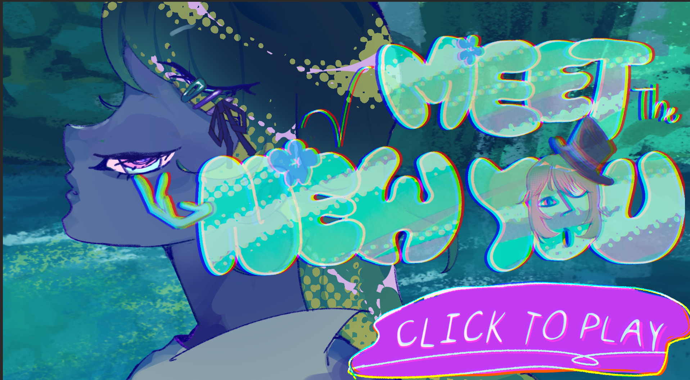
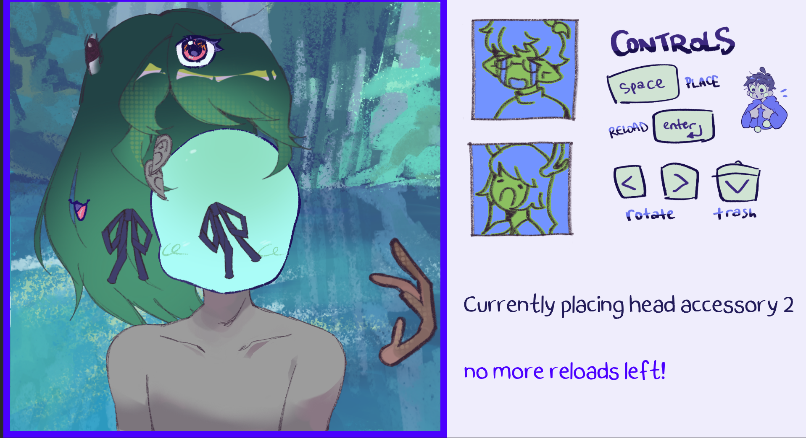
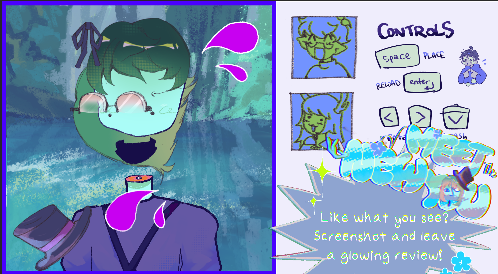

# haven toronto game: meet the new you
We welcome you, apprentice, to the zen haven of *Incurby*! Those who look to bounce back from their struggles require your reshaping services. Build them a new, exquisite self.

# screenshots

# how to play
go to the itch.io page to play. controls are listed in game (keyboard required)

# tools used
* made with godot
* art on procreate and krita
* music by us + a sink in the girls' washroom + edited in audacity
* 100% human-made, no AI was used

# features
* animated title screen and art
* bouncy, rotatable, and reloadable assets
* live random Incurby reactions
* serene waterfall audio x bleep bloop yippie audio
* tons of chances to gamble!

# godot crash counter
* herby: 2

# things we could add
* more customization options
* normal version where the objects are actually aligned lol
* we are aware that the game might break if you spam the buttons :'> might fix sometime

# things we learned
* Herby: hi incurable. what are things that you learned from your first game jam?
* incurable: herby is cracked. also figured out how to easily fill a selected layer in procreate despite pesky ref layers. uhhh also coding hard ;-; godot is really coolllll 
* herby: I think you are really coolllll too :> personally I learned much more about organizing scenes in godot. and that the hardest part of making a game is planning it. also my godot installation cannot export web builds because it has c# support TnT
* incurable: speaking of C#, you added many sfx into the game with ur voice. what did you learn about this experience?
* herby: that was an anonymous voice actor. not me
* herby: but this anonymous voice actor learned that you should spawn new audio nodes instead of referencing existing ones if you don't want your sound effects to stop and replay early
* incurable: i tihnk forcing urself to make a project in a small amount of time was really interesitng. was one of the first times i did smth like this. was very motivating with u there herby. thx for creating with me <3
* -u-

# read our planning below!
the layers are (bottom to top) (z indices)
* background (0)
* bottom hair (1)
* torso + clothes on the same (2)
* head (3)
* ear (NOTE 24,25)
* nose (10)
* mouth (11)
* clothing accessory (15)
* hair bangs (16)
* eyes (20, 21)
* eyebrows (22, 23)
* accessory (horns and stuff) (26, 27)
* hat (28)
* decoration? (30, 31)

collision layers:
* walls are every layer
* 1: torso + clothes (torso can take up more layers) : 3, 4, 5, 7, 8, 9
* 2: more clothes
* 3: head
* 4: ears (2 of them)
* 5: hair 1
* 6: hair 2 (the behind)
* 7: head accessory (2+ of them)
* 8: hat
* 9: face things: eyes, mouth, nose, eyebrows
* 10: decoration
